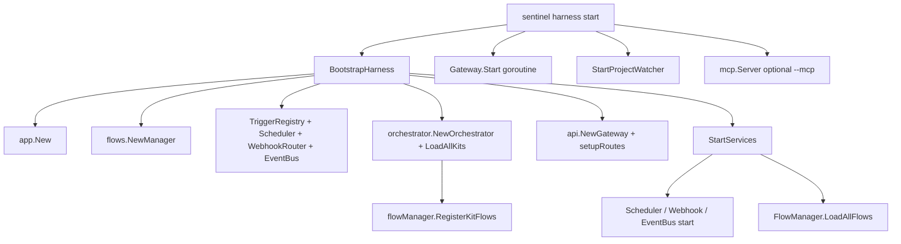
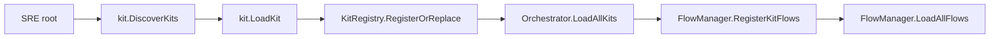
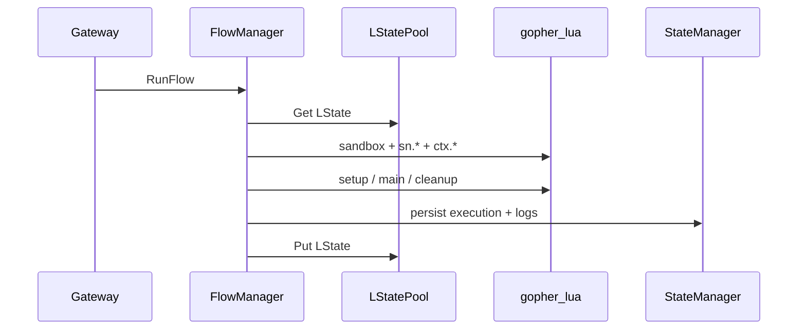

<!-- ndx-ste-mode: description -->

# Harness Internals — Code Architecture

Contributor reference for the Sentinel **harness** Go codebase. This document describes how subsystems are wired, where code lives, and how requests flow through the runtime. The **code is the source of truth**. User-facing behavior is also specified in `system-specs/` and the numbered docs under `docs/`.

**Audience:** engineers modifying `internal/*`, `cmd/sentinel/*`, or debugging harness behavior at runtime.

For SRE/Lua development (kits, flows, triggers), see [Kit Development](/kit-development) and [Lua API Reference](/lua-api). For HTTP route catalogs, see [Harness HTTP Routes](/harness-http-routes) and `system-specs/api.yaml`.

---

## Scope and mental model

Sentinel separates two concerns:

| Layer | Location | Role |
|-------|----------|------|
| **Harness** | This repo (`internal/*`, compiled binary) | Runtime engine: API, Lua VM, triggers, vault, state, kit discovery |
| **SRE** (Sentinel Runtime Environment) | External project directory (`-p`) | Git-tracked kits, flows, connectors, `sentinel.yaml` |

**1:1 deployment:** one harness process serves exactly one SRE. There is no multi-tenant mode or shared worker pool.

**Two processes in normal development:**

| Process | Default port | Entry |
|---------|--------------|-------|
| Harness API | 8080 | `sentinel harness start -p <sre>` |
| Dashboard BFF | 9090 | `sentinel dashboard start --sre-location <sre>` |

The dashboard is a standalone process that proxies HTTP to the harness and maintains its own UI database. See [internal/dashboard/server.go](../internal/dashboard/server.go).

**Embedded SRE content:** this repo does not contain kit directories. `./build.sh` syncs a minimal embed from sibling `../sre-init` for CLI scaffolding only — never add kits under this repo.

---

## Entry points and CLI layer

```
cmd/sentinel/main.go  →  commands.Execute()
```

All commands live under [cmd/sentinel/commands/](../cmd/sentinel/commands/). Important groups:

| Command group | Purpose | Long-running? |
|---------------|---------|---------------|
| `sentinel harness start` | Bootstrap and run the harness | Yes |
| `sentinel dashboard start` | Standalone web UI (BFF) | Yes |
| `sentinel sre init\|test\|kit\|bundle` | Scaffolding and validation | No |
| `sentinel secret`, `backup`, `db`, `storage` | Operational utilities | No |
| `sentinel register`, `login`, `license` | Marketplace / licensing | No |
| `sentinel mcp proxy` | Signing proxy for MCP clients | Optional sidecar |
| `sentinel probes run` | Adversarial probe runner | No |

**Critical convention:** harness subsystem wiring is centralized in [harness_bootstrap.go](../cmd/sentinel/commands/harness_bootstrap.go), not scattered across individual handlers. When adding a new runtime dependency, bootstrap is the integration point.

---

## Bootstrap sequence

`sentinel harness start` calls `BootstrapHarness` → `bootstrapFullHarness`, then `StartServices`, then starts HTTP listeners in [harness_start.go](../cmd/sentinel/commands/harness_start.go).



### HarnessComponents inventory

The `HarnessComponents` struct in [harness_bootstrap.go](../cmd/sentinel/commands/harness_bootstrap.go) is the authoritative list of runtime subsystems:

| Field | Package | Role |
|-------|---------|------|
| `App` | `internal/app` | DI container (configuration, state, vault, Lua pool, forms, CMS cache, license) |
| `FlowManager` | `internal/flows` | Flow discovery, execution, trigger sync |
| `Orchestrator` | `internal/orchestrator` | Kit loading, Lua API registration, PG/RAG/AI wiring |
| `Scheduler` | `internal/triggers` | Cron trigger execution |
| `WebhookRouter` | `internal/triggers` | HTTP webhook ingress |
| `EventBus` | `internal/triggers` | Internal pub/sub |
| `TriggerRegistry` | `internal/triggers` | Persisted trigger CRUD |
| `TriggerSync` | `internal/triggers` | Flow-defined trigger table sync |
| `WSManager` | `internal/ws` | WebSocket bus |
| `Gateway` | `internal/api` | Main Chi HTTP server |
| `WPGateway` | `internal/api` | Optional wp-central ingress-only server |
| `KitLifecycle` | `internal/kit` | Per-kit reload, disable, enable |
| `KitCache` | `internal/kit` | Page render cache |
| `BackupManager` | `internal/backup` | Scheduled backups |
| `DockerOrch` | `internal/docker` | Compose stack management |
| `PhoneHome` | `internal/marketplace` | Registration check-in |
| `GitSync` | `internal/git` | Auto git pull/push when configured |
| `MCPServer` | `internal/mcp` | MCP streamable HTTP sidecar |
| `ProjectWatcher` | `internal/orchestrator` | fsnotify hot-reload |
| `MaintenanceMgr` | `internal/dbutil` | Kit DB maintenance cron jobs |

### WP-proxy-only mode

When `bootstrapWPProxyOnly` runs (through `--wp-proxy-only` paths), only `App`, vault/state, and a minimal `WPGateway` with `WithWPCentralIngressOnly()` are initialized. Flows, triggers, orchestrator, Lua, and marketplace subsystems are skipped.

### Start and shutdown order

**StartServices** ([harness_bootstrap.go](../cmd/sentinel/commands/harness_bootstrap.go)):

1. Scheduler → WebhookRouter → EventBus.
2. BackupManager schedule sync.
3. PhoneHome (optional).
4. WSManager (if enabled).
5. GitSync (if `sentinel.yaml` git.sync = `auto`).
6. FlowManager.LoadAllFlows.

**Gateway.Start** runs in a separate goroutine from `harness_start.go` (main + optional WPGateway).

**ShutdownServices** reverses startup: ProjectWatcher → PhoneHome → GitSync → MCP → WS → EventBus → Webhook → Scheduler → Gateways → App.Shutdown.

---

## Application container (`internal/app`)

[internal/app/app.go](../internal/app/app.go) owns shared infrastructure created before subsystem wiring.

### Initialization order

```
Logger → StateManager → VaultManager → LuaPool → FormSystem → ContentCache → LicenseManager
```

### Shutdown order (reverse)

```
ContentCache → FormSystem → LuaPool → VaultManager → StateManager
```

### Options for lightweight CLI paths

`app.Options` supports skipping subsystems that CLI commands do not need:

| Flag | Effect |
|------|--------|
| `SkipVault` | No vault even if passphrase is set |
| `SkipLuaPool` | No Lua VM pool |
| `SkipFormSystem` | No form coordinator |

### Component interface

Lifecycle types are re-exported from [internal/health](../internal/health) through [internal/app/component.go](../internal/app/component.go):

```go
type Component interface {
    Start(ctx context.Context) error
    Stop(ctx context.Context) error
    Health() Status
}
```

Orchestrator, FormSystem, WSManager, and other subsystems implement this pattern where applicable.

---

## Configuration layers

Two configuration files serve different purposes (see [Configuration Guide](/configuration-guide)):

| Layer | File | Loader | Contains |
|-------|------|--------|----------|
| Machine infra | `.sentinel/config.json` | `config.Load` through koanf | `api.port`, `data_dir`, `vault_passphrase`, TLS, marketplace, WS |
| Project behavior | `sentinel.yaml` | `config.LoadProjectConfig` | `name`, `hotreload`, `git`, `wp_central`, `default_kit`, limits |

Environment variables (`SENTINEL_*`) override configuration file values. See [internal/config/env.go](../internal/config/env.go).

### Build modes

Compile-time tags select behavior in [buildmode_dev.go](../internal/config/buildmode_dev.go) vs [buildmode_prod.go](../internal/config/buildmode_prod.go):

| Constant | `go build -tags dev` | Production (default) |
|----------|----------------------|----------------------|
| `DevModeAllowed` | `true` | `false` |
| `PrereleaseRegistrationBypass` | `false` | `true` (set `false` before public release) |

Production builds require a valid marketplace license for flow/trigger **execution** (discovery and listing remain available).

---

## Package map

Top-level packages under [internal/](../internal/), grouped by role:

| Group | Packages | Role |
|-------|----------|------|
| **Core runtime** | `app`, `config`, `health`, `logger`, `safety`, `util`, `version` | DI, configuration, logging, crash recovery |
| **HTTP surface** | `api`, `httputil`, `requestparams` | Chi gateway, handlers, middleware, brevity routes |
| **Execution** | `flows`, `luavm`, `lua`, `connectors`, `modules`, `luatest`, `luautil` | Flow lifecycle, sandbox, `sn.*` registration |
| **Kit platform** | `orchestrator`, `kit`, `scaffold`, `templates`, `templatesync`, `library` | Discovery, loading, pages/forms, API library |
| **Triggers & events** | `triggers`, `events` | Cron, webhooks, event bus, flow-defined triggers |
| **Forms & UI data** | `forms`, `cache`, `uploads`, `yaml`, `core` | FormSystem, template pipeline, submissions |
| **Persistence** | `state`, `vault`, `dbutil`, `pgmanager` | SQLite state, encrypted vault, kit DBs, PG pools |
| **Content** | `cms`, `storage`, `storagebundle` | CMS cache (`cms.db`), S3-compatible storage |
| **Realtime** | `ws` | WebSocket bus + Lua bindings |
| **Security** | `security`, `auth`, `fsaccess` | Audit logging, auth helpers, filesystem policy enforcer |
| **Ops & integration** | `docker`, `backup`, `git`, `marketplace`, `mcp`, `probes` | Compose stacks, backups, SKM, MCP server |
| **AI / RAG** | `ai`, `rag`, `session` | AI client, RAG control plane, memory sessions |
| **Dashboard** | `dashboard` | Standalone BFF + SQLCipher UI DB |
| **CLI & embed** | `cli`, `static`, `sreinit` | Terminal formatting, embedded assets |
| **Testing** | `testutil`, `luatest` | Harness unit/integration helpers |

**Note:** `internal/router` exists for unified messaging experiments but is **not wired** into the main harness bootstrap path.

---

## Kit discovery and orchestrator

The path from SRE files to running flows:



### Discovery rules

1. **`kit.DiscoverKits(sreRoot)`** — scans for directories matching `{ns}.{name}/kit.yaml` ([discover.go](../internal/kit/discover.go)).
2. **`kit.LoadKit(path)`** — parses manifest and auto-discovers subdirectories ([loader.go](../internal/kit/loader.go)):

   | Directory | Content |
   |-----------|---------|
   | `fl/` | Flow Lua scripts |
   | `pg/` | Kit pages (YAML and/or Lua merge scripts) |
   | `fm/` | Form YAML definitions |
   | `cn/` | Connectors |
   | `md/` | Modules |
   | `dd/` | Data definitions |
   | `db/` | Kit SQLite databases (through KitDatabaseManager) |

3. **`Orchestrator.LoadAllKits`** — initializes PG manager, kit DB manager, library service, AI client, RAG manager, memory sessions, then calls `loadKitsFromDisk` ([registry.go](../internal/orchestrator/registry.go)).

### Flow ID convention

Kit flows use `{namespace}.{kit-name}/{flow-basename}`:

```
sn.core/fl/assistant.lua  →  sn.core/assistant
```

Legacy system flows under project `fl/` (without kit prefix) use bare IDs.

### Kit lifecycle

[KitLifecycle](../internal/kit/lifecycle.go) coordinates per-kit reload, disable, and enable. It is wired in bootstrap and exposed through `/hl/kt/{ns}/{name}/rl|off|on`. Design details: [specs/kitlife.md](https://github.com/ndx-au/sentinel/blob/main/specs/kitlife.md).

---

## Flow execution path

[internal/flows/manager.go](../internal/flows/manager.go) bridges the HTTP API to gopher-lua execution and state persistence.



### Lua injection points (set in bootstrap)

| Hook | Registered by | Purpose |
|------|---------------|---------|
| `SetLuaStateSetup` | `orch.RegisterLuaState(L)` | Global `sn.*` primitives (including HTTP, JSON, and DB schema) |
| `SetLuaFlowSetup` | Per-flow closures | Kit DB, CMS, WebSocket APIs scoped to flow's kit |
| `SetCtxSetup` | Bootstrap closure | `ctx.secret`, `ctx.pg`, `ctx.project_config`, `ctx.keyhole` |
| `SetTriggerSync` | `FlowTriggerSync` | Sync Lua `triggers` table on flow load |
| `SetTriggerHelperRegistrar` | `triggers.RegisterTriggerHelpers` | Trigger helper functions in VM |
| `SetEventBus` | EventBus instance | `sentinel.emit()` from flows |
| `SetWSManager` | WSManager | Execution lifecycle WS events |
| `SetLicenseGate` | LicenseManager | Block execution when unlicensed (prod) |
| `SetFSEnforcer` | fsaccess.Enforcer | Filesystem write policy for file connector |

### Lua VM pool security

[internal/luavm/pool.go](../internal/luavm/pool.go):

- `SkipOpenLibs: true` — only safe standard libraries are opened manually.
- One `LState` per execution — gopher-lua states are **not goroutine-safe**.
- Pool reuses states after stack cleanup through `Put()`.

### Flow lifecycle hooks

Each flow script can define:

| Function | When called |
|----------|-------------|
| `setup()` | Before `main`, once per execution |
| `main()` | Primary work |
| `cleanup()` | After successful `main` |
| `failed(err)` | On error (if defined) |

Triggers (cron, webhook, event, form, manual) all converge on the same execution path through FlowManager.

---

## HTTP gateway (`internal/api`)

[internal/api/gateway.go](../internal/api/gateway.go) is the harness HTTP surface.

### Middleware chain

Order in `setupMiddleware()`:

```
stripTrailingSlash → CORS → requestID → recoverer → auth → IP filter (optional)
```

| Middleware | Behavior |
|------------|----------|
| `authMiddleware` | Bearer tokens or Ed25519 signatures. Skipped in debug mode (IP whitelist enforced instead) |
| `ipFilterEngine` | Per-service path rules (harness vs wp-proxy) |
| Public keys | Loaded from `{SRE}/.sentinel/pub-keys/*.pub` for dashboard/agent signatures |

MCP reuses harness auth through `Gateway.HTTPAuthMiddleware()` ([harness_mcp.go](../cmd/sentinel/commands/harness_mcp.go)).

### Response contract

**Always HTTP 200.** Errors appear in the JSON body:

```json
{"ok": false, "err": "CODE", "msg": "human-readable message"}
```

This is an architecture lock — do not return 4xx/5xx for application errors.

### Dependency injection

Optional subsystems attach through `GatewayOption` functions during `NewGateway`. They include the vault, forms, kit registry, triggers, Docker, RAG, and AI. Other subsystems include the marketplace, backups, WebSockets, CMS cache, FS enforcer, and TLS manager.

### Route catalog

Routes are registered in `setupRoutes()`. Prefixes follow the brevity regime (`/fl`, `/ex`, `/tr`, `/wh`, `/kt`, …). Do not duplicate the full table here — use:

- [Harness HTTP Routes](/harness-http-routes).
- `system-specs/api.yaml`.
- [sre-url-map.md](https://github.com/ndx-au/sentinel/blob/main/sre-url-map.md).

---

## Trigger engine

Package: [internal/triggers/](../internal/triggers/)

| Component | Responsibility |
|-----------|----------------|
| `TriggerRegistry` | CRUD for triggers. Persisted in state DB |
| `Scheduler` | Cron jobs through robfig/cron. Also hosts system maintenance jobs |
| `WebhookRouter` | HTTP POST ingress. HMAC/bearer auth, rate limits |
| `EventBus` | Pattern-matched pub/sub. Used by forms, WS, phone-home |
| `FlowTriggerSync` | Reads Lua `triggers` table when flows load. Syncs to registry |

Trigger types: **cron**, **webhook**, **event**, **manual**, **form**.

Flow-defined triggers (Lua table) and YAML/config triggers both land in the same registry. `FlowTriggerSync` prevents import cycles between `flows` and `triggers` packages through interfaces.

---

## Form system

Package: [internal/forms/](../internal/forms/)

`FormSystem` is a coordinator implementing `core.Component`:

| Sub-component | Role |
|---------------|------|
| YAML loader | Parses form definitions from kit `fm/` |
| Template loader/renderer | Go templates + optional Lua before/after hooks |
| Cache manager | Response cache under `{data_dir}/cache/responses` |
| Upload manager | Multipart file handling |
| Event coordinator | On submission, executes wired flows through EventExecutor |

Bootstrap wires:

- `FormSystem.SetEventExecutor(flowManager)` — form submissions trigger flows.
- `FormSystem.EventCoordinator().SetKitFlowGuard(KitLifecycle)` — disabled kits block form-triggered flows.
- `ProjectWatcher` reloads forms/templates on file change when hot-reload is enabled.

---

## State, vault, and on-disk artifacts

Cross-reference [The `.sentinel/` directory](/sentinel-directory) for operator-facing inventory. Code ownership:

| Artifact | Package | Resolved path |
|----------|---------|---------------|
| Executions, triggers, audit, AI policy | `state` | `{data_dir}/state.db` |
| Secrets | `vault` | `{data_dir}/vault.db` (AES-256-GCM) |
| CMS parsed cache | `cms` | `{data_dir}/cms.db` |
| Form response cache | `forms` / `cache` | `{data_dir}/cache/responses` |
| Uploads | `uploads` | `{data_dir}/uploads` |
| Crash reports | `safety` | `{data_dir}/crash/` |
| Dashboard UI state | `dashboard` | Separate SQLCipher DB (not in harness data_dir) |

`data_dir` defaults relative to SRE root through `.sentinel/config.json`. State DB encryption uses SQLCipher when `state.encrypt_db` is enabled.

Kit-scoped SQLite databases live under `{ns}.{name}/db/` and are managed by `kit.KitDatabaseManager`.

---

## Hot reload

[ProjectWatcher](../internal/orchestrator/project_watcher.go) uses fsnotify with debouncing (default 100ms) when started through `StartProjectWatcher`.

Monitored changes inside kit directories:

| Path pattern | Action |
|--------------|--------|
| `fl/*.lua` | Flow hot-reload |
| `cn/`, `md/` | Component reload + skill twin spawn |
| `fm/` | Form YAML reload |
| `pg/`, `tp/` | Page/template reload |
| `ct/` | CMS content cache rebuild |
| `kit.yaml` | Kit manifest reload |

Skill twins (`.md` siblings) are auto-spawned for supported extensions (including `.lua`, `.yaml`, and `.gohtml`).

Gated by project configuration: `sentinel.yaml` → `hotreload` configuration, including `yaml_reload_mode` (`full` or `safe`).

SRE-wide reload is also available through `POST /hl/reload` and `SIGUSR1` to the harness process.

---

## Satellite processes and integrations

### Dashboard BFF

[internal/dashboard/server.go](../internal/dashboard/server.go):

- Discovers running harness instances (port scan).
- Proxies REST to harness. Maintains local SQLCipher DB for UI preferences.
- Own WebSocket server fans out harness events to browser clients.
- Does **not** execute Lua flows directly.

### MCP server

[internal/mcp/](../internal/mcp/) — optional sidecar enabled with `sentinel harness start --mcp`. Listens on API port + 100 by default. See [MCP Agent Integration](/mcp-agent-integration).

### Marketplace

[internal/marketplace/](../internal/marketplace/):

- `LicenseManager` — Ed25519 license verification. Gates flow execution in prod.
- `Installer` — kit download with signature verification.
- `AuthManager` — SKM OAuth token storage.
- `CheckIn` — phone-home registration telemetry.

### Docker orchestrator

[internal/docker/](../internal/docker/) manages compose stacks from templates in [internal/static/docker-templates/](../internal/static/docker-templates/). Exposed through `/docker` API routes and dashboard.

### FS Control

[internal/fsaccess/](../internal/fsaccess/) — policy enforcer for file connector writes. Policies stored in state DB. Exposed through `/fs/pl` API and `ctx.fs` Lua binding.

### Git sync

[internal/git/](../internal/git/) — when `sentinel.yaml` sets `git.sync: auto`, `GitSyncManager` runs periodic pull/push and emits events on the EventBus.

---

## Build, test, and conventions

### Build

Always use `./build.sh` — syncs minimal sre-init embed before compile. Do not run bare `go build` on a clean checkout.

### Integration testing

Use an external SRE:

```bash
sentinel harness start -p ../SRE/test --daemon
sentinel dashboard start --sre-location ../SRE/test
```

Override with `$SENTINEL_TEST_SRE`. **Never** add kit directories or flows under this repo.

Unit tests use `t.TempDir()` or [internal/testutil](../internal/testutil/).

### Code conventions

| Convention | Pattern |
|------------|---------|
| Interfaces | `interfaces.go` per package |
| Errors | Package-level vars: `var ErrNotFound = errors.New("...")` |
| Logging | slog-style: `logger.Error("msg", "key", val, "error", err)` |
| API naming | Brevity regime: two-char routes and query params |
| Route changes | Require explicit approval before modifying router table |
| Docs sync | Update `system-specs/` and relevant `docs/` when behavior changes |

### Changing routes

Before modifying routes in `gateway.setupRoutes()`, pause and confirm with maintainers. Update `system-specs/api.yaml`, [15-HARNESS-HTTP-ROUTES.md](/harness-http-routes), and `sre-url-map.md` together.

---

## Related references

| Resource | Purpose |
|----------|---------|
| [CLAUDE.md](https://github.com/ndx-au/sentinel/blob/main/CLAUDE.md) | Agent rules, package layout summary, common mistakes |
| [specs/kitlife.md](https://github.com/ndx-au/sentinel/blob/main/specs/kitlife.md) | Kit enable/disable and reload design |
| [system-specs/](../system-specs/) | Machine-readable API, configuration, trigger, Lua contracts |
| [sre-url-map.md](https://github.com/ndx-au/sentinel/blob/main/sre-url-map.md) | URL construction cheat sheet |
| [sre4agents.md](https://github.com/ndx-au/sentinel/blob/main/sre4agents.md) | Full SRE development reference |
| `.claude/skills/sn-go-*` | Per-subsystem harness skills (lua, triggers, forms, configuration, security, dashboard, …) |
| [16-SENTINEL-DIRECTORY.md](/sentinel-directory) | On-disk artifact inventory |
| [18-MCP-AGENT-INTEGRATION.md](/mcp-agent-integration) | MCP server setup |
| [10-ADVERSARIAL-TESTING.md](/adversarial-testing) | Probe runner for harness QA |

---

## Key source files (quick index)

| Concern | Primary file |
|---------|--------------|
| CLI entry | [cmd/sentinel/main.go](../cmd/sentinel/main.go) |
| Harness wiring | [cmd/sentinel/commands/harness_bootstrap.go](../cmd/sentinel/commands/harness_bootstrap.go) |
| Harness runtime loop | [cmd/sentinel/commands/harness_start.go](../cmd/sentinel/commands/harness_start.go) |
| App container | [internal/app/app.go](../internal/app/app.go) |
| HTTP gateway | [internal/api/gateway.go](../internal/api/gateway.go) |
| Flow execution | [internal/flows/manager.go](../internal/flows/manager.go) |
| Kit loading | [internal/orchestrator/registry.go](../internal/orchestrator/registry.go) |
| Kit discovery | [internal/kit/discover.go](../internal/kit/discover.go), [loader.go](../internal/kit/loader.go) |
| Hot reload | [internal/orchestrator/project_watcher.go](../internal/orchestrator/project_watcher.go) |
| Lua pool | [internal/luavm/pool.go](../internal/luavm/pool.go) |
| Configuration | [internal/config/config.go](../internal/config/config.go) |
| Dashboard | [internal/dashboard/server.go](../internal/dashboard/server.go) |
